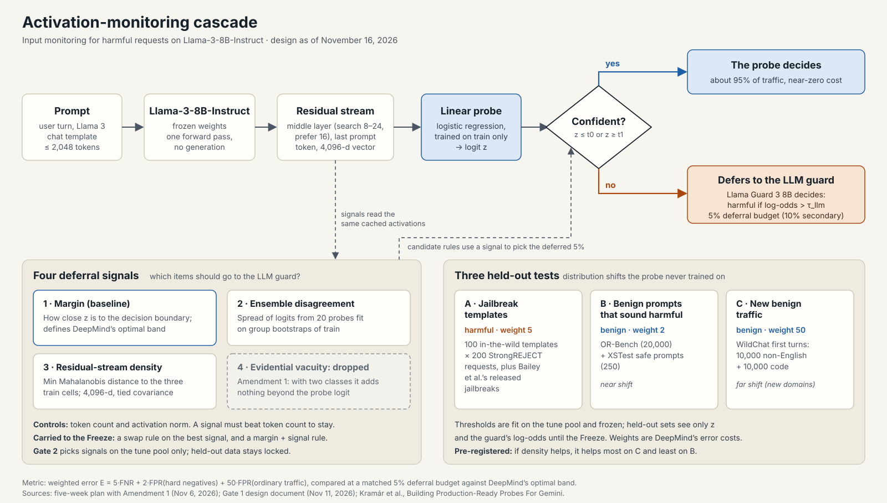
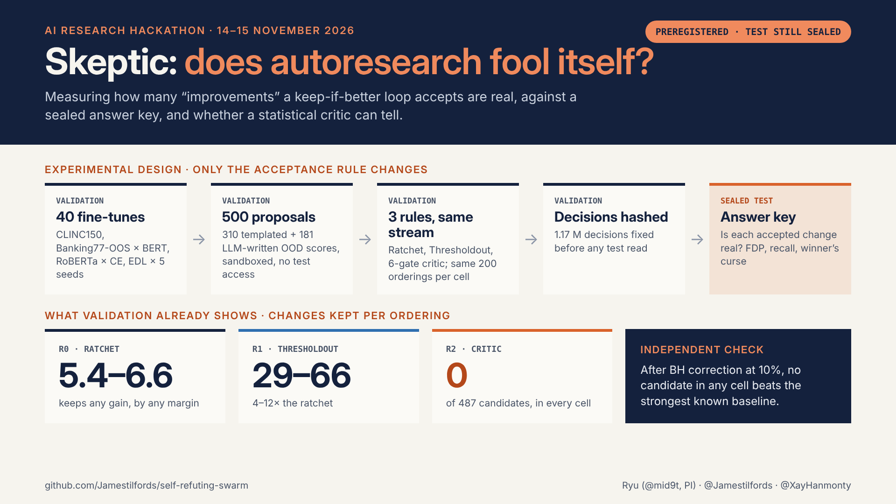
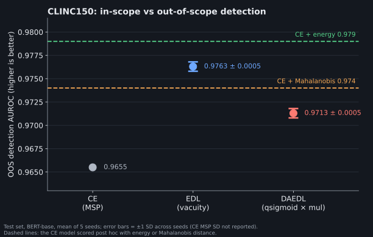

<h1 align="center">Hi, I'm Ryu Kakuta 👋</h1>
<h3 align="center">Research Engineer · AI Safety · Uncertainty Quantification in NLP</h3>


<p align="center">
I study when a model's signals can be trusted — whether it knows it's guessing, whether a measured gain is real, and whether a safety monitor knows when to hand off.
</p>

<p align="center">
<a href="https://mid9t.github.io/RyuKakuta.github.io/"></a>
<a href="https://www.linkedin.com/in/kakury/"></a>
<a href="mailto:kakuryu555@gmail.com"></a>
<a href="https://drive.google.com/file/d/1C9Dhx1d-iXLT55JD-BOZ-fEj9R-vqj1i/view?usp=sharing"></a>
</p>

---

### 🎯 What I'm working on

I'm a research engineer focused on **statistical validity**, **AI safety**, and **uncertainty quantification in NLP**. My running question is **can we tell when a signal is trustworthy?** That started with uncertainty in a classifier's predictions, moved to whether experimental "wins" survive honest statistics, and now sits on **activation probes over the residual stream**: cheap monitors that read a model's internals, and the question of when they should defer to something stronger.

Day to day, I'm an **AI Evaluation Engineer (Post-Training) at [Handshake](https://joinhandshake.com)**, building RL environments and containerized coding tasks that stress-test frontier agents: scoring gates, difficulty calibration, and telling model failures apart from harness failures.

```
uncertainty quantification  →  statistical validity  →  AI oversight
 (is the model guessing?)      (is the gain real?)      (when should the monitor defer?)
```

---

### 🔬 Current builds

**1. [Activation Probes](https://github.com/mid9t/Activation-Monitoring): epistemic deferral for safety monitors**

<p align="center">
  
  <br>
  <sub>Probe first, Llama Guard 3 on deferral. Margin is the baseline; evidential vacuity was dropped.</sub>
</p>

A two-stage cascade for screening harmful requests: a linear probe on frozen Llama-3-8B-Instruct activations decides the confident cases (about 95% of traffic), and Llama Guard 3 takes the rest inside a 5% deferral budget. I test whether ensemble disagreement and residual-stream density beat the margin baseline — DeepMind’s optimal score band — on three held-out shifts: jailbreak templates, benign prompts that sound harmful, and new benign traffic. Evidential vacuity was dropped: with two classes it adds nothing beyond the probe logit. Thresholds are fit on the tune pool and frozen before any held-out data is opened.

`PyTorch` · `Llama-3-8B` · `Linear Probes` · `Llama Guard 3` · `Bootstrap Inference`

**2. [Skeptic](https://github.com/Jamestilfords/self-refuting-swarm): do automated research loops fool themselves?**

<p align="center">
  <a href="https://drive.google.com/file/d/1AcFYQGjtcfUy0MQgPs4nuv7faYg9P0rR/view?usp=sharing">
    
  </a>
  <br>
  <sub>📊 Click to view the full slide deck</sub>
</p>

A collaborative project that runs the same stream of agent-proposed model changes through three acceptance rules (keep-if-better, Thresholdout, and a statistical critic) and measures false discoveries against recall. Proposals run in network-isolated sandboxes, test data stays sealed from agents, and every decision goes to an append-only ledger under a registered pre-analysis plan.
📊 [Slides](https://drive.google.com/file/d/1AcFYQGjtcfUy0MQgPs4nuv7faYg9P0rR/view?usp=sharing)

`Python` · `Modal Sandboxes` · `Paired Bootstrap` · `Holm Correction` · `Streamlit`

---

### ✅ Finished — [ER-1: Epistemic Ranker](https://github.com/mid9t/ER-1-Epistemic-Ranker-)

<p align="center">
  
  <br>
  <sub>Out-of-scope AUROC on CLINC150, BERT-base, 5 seeds. EDL vacuity 0.9763 beat DAEDL 0.9713. Dashed lines: CE + energy 0.979, CE + Mahalanobis 0.974.</sub>
</p>

**Question:** Does density-aware Evidential Deep Learning (DAEDL), ported from vision to BERT, improve out-of-scope detection on CLINC150?
**Conclusion:** No, not in the headline score. Density scaling was measurably active, but plain EDL vacuity (AUROC 0.9763) beat the density-scaled variant (0.9713) across 5 seeds, and the gap didn't clear seed noise. Raw density alone was a strong OOS signal; it just didn't add anything to the combination rule. On the same plot, post-hoc scores of the CE model are MSP 0.9655, energy 0.979, and Mahalanobis 0.974.
**Contribution:** A leak-free three-arm pipeline (CE / EDL / DAEDL) on shared features; a diagnostics gate that disqualifies configs where the density term is inert; identification of that "INERT" failure mode from a CIFAR replication; and NLP-specific density normalization.

---

### 📌 Selected projects

| Project | What it does | Stack |
|---|---|---|
| **[Activation Probes](https://github.com/mid9t/Activation-Monitoring)** | Uncertainty-gated deferral for probe-based safety monitors | PyTorch, Llama-3, Probes |
| **[Skeptic](https://github.com/Jamestilfords/self-refuting-swarm)** | Measures false discoveries in agent-driven research loops | Python, Modal, Bootstrap |
| **[ER-1: Epistemic Ranker](https://github.com/mid9t/ER-1-Epistemic-Ranker-)** | Audit of density-aware EDL for out-of-scope intent detection | PyTorch, EDL, HuggingFace |
| **[GeoGenie](https://github.com/mid9t/GeoGenie)** | Free-text intent → structured spatial queries over hand-built geometric indices | Python, NumPy, FastAPI, LLMs |
| **[RCA-Demo](https://github.com/mid9t/RCA-Demo)** | Automated root-cause analysis for sales anomalies (synthetic data) | Python, SHAP, Statistical Modeling |
| **EEG-Based MDD Classification** | End-to-end clinical signal pipeline, built around leakage prevention and evaluation rigor | CNNs, Granger Causality |

---

### ✍️ Featured writing

**[Does Density Help Out-of-Scope Detection? Auditing DAEDL on BERT](https://medium.com/data-science-collective/does-density-help-out-of-scope-detection-auditing-daedl-on-bert-04fcdb7ac8d4)** · *Data Science Collective*
The write-up for ER-1: what happened when I ported density-aware EDL to language, why the density term can silently go inert, and why the honest answer turned out to be "not really."

**[Evidential BERT on CLINC150: porting density-aware EDL from vision to language](https://mid9t.github.io/RyuKakuta.github.io/articles/evidential_bert_article/)**
The theory-and-engineering companion piece on adapting DAEDL to BERT embeddings.

---

### 🧭 Path here

- **UC Berkeley** — B.A. Data Science
- **Terra Drone Corporation** — Data Systems Intern, automated GCP + SQL reporting pipelines
- **Fractal Analytics** — Research SWE Intern, ML infra for sales-forecast anomaly diagnosis (SHAP-validated)
- **Handshake** — AI Evaluation Engineer, Post-Training *(current)*

---

<p align="center">
<sub>Open to conversations about AI safety, uncertainty quantification, and statistically honest evaluation. My inbox is always open — <a href="mailto:kakuryu555@gmail.com">say hello</a>.</sub>
</p>
